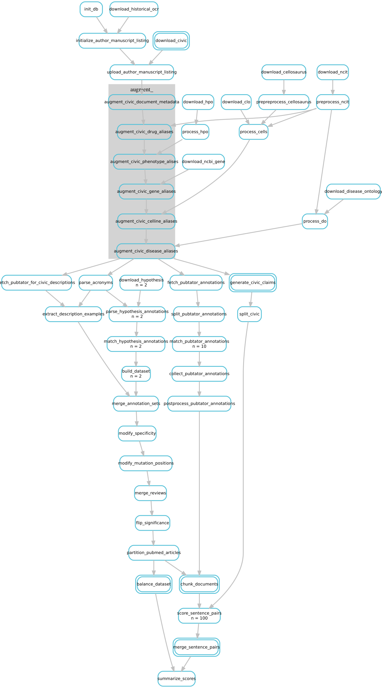

# CIViC-Fact Claim Verification Dataset

- [Using the Released Dataset](#using-the-released-dataset)
- [Data Format](#data-format)
  - [Evidence](#evidence)
  - [Claim](#claim)
  - [Reviews](#reviews)
- [Data Preprocessing](#data-preprocessing)
  - [Data Cleaning](#data-cleaning)
  - [Data Augmentation](#data-augmentation)
- [Getting Started Building the Dataset (Developers)](#getting-started-building-the-dataset-developers)
- [Workflow](#workflow)
- [Data License](#data-license)

CIViC-Fact is a companion dataset to the CIViC knowledgebase that links structured cancer variant interpretations to evidence from their source publications. Each CIViC Evidence Item is treated as a claim, with relevant sentence-level evidence manually selected by expert curators using hypothes.is.

The released dataset provides two complementary resources in compressed JSONL format:

- **`data.jsonl.gz`** contains claim/evidence pairs for claim verification, including original and generated examples with reference labels (`SUPPORTS`, `REVISIONS`, or `NEI`).
- **`retrieval.jsonl.gz`** contains structured CIViC claims paired with manually annotated evidence spans, including their locations within the source publications.

Claims are represented as structured JSON objects, while evidence spans are stored with associated metadata. The `claim.flat` and `evidence.flat` fields provide text representations for model input, with multiple evidence excerpts concatenated using ellipsis delimiters.

The following example illustrates the relationship between a CIViC claim and its supporting evidence. For readability, only selected claim fields are shown in tabular form; the released data uses the structured JSON representation described below.

claim

| molecular profile | evidence type| significance | therapies | diseases |
|---|---|---|---|---|
| EGFR::RAD51 Fusion  | predictive | sensitivity/response   | Erlotinib |  Lung Adenocarcinoma|

evidence

> Patient 1, a 35-year-old female, was diagnosed with metastatic lung adenocarcinoma after presenting with generalized weakness and worsening vision. . . . A lymph node biopsy was sent for genomic profiling using an extensively validated hybrid capture-based NGS diagnostic platform (FoundationOne(r)) and found to harbor a novel EGFR rearrangement at exon 25, resulting in the formation of a fusion gene between EGFR and RAD51 . . . Within two weeks of erlotinib initiation, DIC had resolved (Supplementary Fig. S1A) and the patient experienced clinical improvement with a noticeable decrease in supraclavicular lymphadenopathy and a hard palate metastatic lesion. After six months of treatment, the primary left lung mass and largest two liver lesions had decreased by 69% per RECIST (Fig. 1C, Supplementary Fig. S1B), and the patient experienced an improvement in her functional status.

There are several steps in pre-processing the data we have done to both clean and augment the dataset. We aimed to keep as much metadata as possible in the dataset to increase utlity for downstream users.

The data builds themselves are found under the builds directory versioned by the date they were generated


## Using the Released Dataset

The CIViC-Fact dataset is available in compressed JSONL format. The dataset used in this study is [v2026.06.09](https://github.com/creisle/civicfact/releases/tag/v2026.06.09).

Two files are provided under `builds/civicfact-2026.06.09/`:

- **`data.jsonl.gz`**: Claim/evidence pairs for claim verification, including manually curated and synthetically generated examples, reference labels (`SUPPORTS`, `REVISIONS`, `NEI`), and train/development/test assignments.
- **`retrieval.jsonl.gz`**: Original structured CIViC claims linked to manually annotated sentence-level evidence, including annotation metadata and evidence locations. Use this file to examine the evidence provenance or construct passage-retrieval evaluations.

### Loading the data

After cloning the repository, either dataset can be loaded with Python's standard library:

```python
import gzip
import json
from pathlib import Path

build_dir = Path("data_builder/builds/civicfact-2026.06.09")


def load_jsonl(filename):
    with gzip.open(build_dir / filename, "rt", encoding="utf-8") as file:
        return [json.loads(line) for line in file]


data = load_jsonl("data.jsonl.gz")
retrieval = load_jsonl("retrieval.jsonl.gz")
```

For claim verification, select examples by their `partition` field:

```python
train = [row for row in data if row["partition"] == "train"]
dev = [row for row in data if row["partition"] == "dev"]
test = [row for row in data if row["partition"] == "test"]

example = train[0]
print(example["claim.flat"])
print(example["evidence.flat"])
print(example["gold_label_name"])
```

Records with `partition = "unassigned"` are not included in the benchmark training, development, or test partitions.

For the original evidence annotations, access the structured claim and its annotated evidence spans:

```python
example = retrieval[0]

print(example["claim"]["content"])

for span in example["evidence"]:
    print(span["content"])
    print(span["meta"]["section"])
    print(span["meta"]["start"], span["meta"]["end"])
```

Evidence metadata includes the source document section, text offsets, and hypothes.is annotation identifiers. See [Data Format](#data-format) for additional fields.


## Data Format

The following fields describe the claim-verification records in `data.jsonl.gz`. The `retrieval.jsonl.gz` dataset contains a subset of these fields, focused on original CIViC claims and manually annotated evidence rather than generated claim/evidence pairs.

If the claim maps directly to a CIViC evidence item, then the following fields are copied directly from that CIViC evidence item to include in the data file for posterity at the time of the build

- civic.description
- civic.claim `dict`: The original structured CIViC claim, before any modifications used for data augmentation
- civic.flagged `bool`
- civic.id
- civic.status `str`: ACCEPTED, REJECTED, or SUBMITTED

Fields that directly relate to the article metadata are below

- document.doi `str`
- document.license `str`: The license status in PMC
- document.pmcid `str`: PMC ID
- document.pmid `str`: pubmed ID
- document.title `str`

Remaining Fields

- claim `dict`: The structured claim used for verification, containing `content`, `meta`, and `type`
- claim.flat `str`: The structured claim serialized as a formatted JSON string
- claim.generated `bool`: If this field is true, the claim was generated as part of data augmentation and does not necessiarly map to a particular item in CIViC
- claim.id `str`: Identifier of the claim; may match the original CIViC Evidence Item ID
- claim.source `str`: The source the claim was dervived from, generally CIViC for non-augmented data
- conversation: A representation of the comment history from hypothes.is
- display_id `str`: UUID identifying the displayed example
- evidence `List[dict]`: Evidence spans, each containing `content`, `meta`, and `type`
- evidence.flat `str`: The flattened evidence
- evidence.generated `bool`: If true, the evidence was not selected by a human curator via hypothes.is but is augmented data
- evidence.id `str`: Identifier of the evidence selection; may contain multiple concatenated hypothes.is annotation IDs
- evidence.selection_method `str`: how evidence was selected
- evidence.source `str`: The source used to get the article content
- example `str | int | null`: Identifier distinguishing alternative evidence selections for a claim, where applicable
- flagged `bool`: If this claim/evidence pair was flagged either in civic or hypothesis. Indicates a possible error in the data and should be reviewed or used more carefully
- generated `bool`: True when the data was generated as part of data augmentation
- gold_label_name `str`: One of three possible labels: SUPPORTS, REVISIONS, or NEI indicating the stance of the evidence toward the claim
- hypothesis.tag: Tags from the original hypothesis file
- hypothesis.username `str`: The name of the user who curated the hypothes.is selections
- id `str`: UUID identifying the claim/evidence pair
- in_table `bool`: Indicates whether the evidence selection is associated with a table
- original_example `UUID`: Links to another row if this is an augmented data point. This will point to the row it was dervived from
- partition `str`: Benchmark partition (`train`, `dev`, `test`, or `unassigned`); use this field when selecting evaluation splits
- pmid.partition `str`: Partition assigned to the source publication; this may differ from `partition`, which determines whether the claim/evidence pair is included in the benchmark splits
- reviews `List[REVIEW]`: A structured object containing reviews and their explanations of the stance of the evidence for this claim/evidence pair

### Evidence

The Evidence object has three main fields

```json
{
    "content": "str or list[list[str]]",
    "meta": {},
    "type": "table or unstructured"
}
```

An example of an evidence chunk object is given below

```json
{
  "content": "Summary of ERBB2 mutants analyzed along with the IC50 values against reversible inhibitors lapatinib and AEE788.",
  "meta": {
    "end": 5693.0,
    "hypothesis.comment": "gene, drug, response metric (IC50)",
    "hypothesis.id": "LLuN9J8rEey2Sw99rAb_0Q",
    "section": "article//results and discussion",
    "start": 5581.0
  },
  "type": "unstructured"
}
```

### Claim

Claims are represented as structured JSON objects with three fields:

- `content`: A dictionary containing the structured CIViC claim fields, such as molecular profile, disease, evidence type, significance, therapies, and evidence direction.
- `meta`: Additional metadata, including synonyms and ontology cross-references for entities in the claim.
- `type`: Identifies the object as a claim.

An example from the released dataset is shown below (synonym metadata abbreviated for readability):

```json
{
  "content": {
    "disease": "Colorectal Cancer",
    "evidenceDirection": "DOES_NOT_SUPPORT",
    "evidenceType": "PROGNOSTIC",
    "molecularProfile": "KRAS G12 OR KRAS G13D",
    "significance": "poor outcome",
    "variantOrigin": "SOMATIC"
  },
  "meta": {
    "synonyms": [
      {
        "name": "KRAS G12",
        "synonyms": ["GLY12"],
        "type": "variant"
      }
    ]
  },
  "type": "claim"
}
```

The `claim.flat` field contains the structured claim serialized as a formatted JSON string, which can be used directly as model input.

In `data.jsonl.gz`, the `claim` field represents the claim used for verification, which may differ from the original CIViC claim when examples have been generated or modified. The `civic.claim` field retains the original structured claim where available.

## Data Preprocessing

### Data Cleaning

Text selected through hypothesis often includes formatting marks or loss of whitespace characters. To ensure the evidence we have in the dataset is representative of what a human reading the paper would view we take the text selected via hypothesis and match it to the BioC text of the article which we have obtained via pubmed. The pubmed XML file is downloaded either from the main PMC files or from the authors uploaded manuscript and then transformed into BioC using the biotext package (<https://github.com/jakelever/biotext>). We use the newly matched text to get the position of the selection within the article.

### Data Augmentation

To expand the claim-verification dataset, we generated additional claim/evidence pairs representing different curation scenarios:

1. **CIViC descriptions:** Written Evidence Item descriptions were paired with their corresponding structured claims. Descriptions were assessed for sufficient evidence using PubTator and regular-expression matching; insufficient descriptions were labelled `NEI`.
2. **Generated claims:** Plausible claims were constructed using diseases, variants, and therapies identified in source publications with PubTator, combined with randomly assigned evidence types and significance values. These claims were paired with passages retrieved from the same publication using SPECTER.
3. **Claim modifications:** Existing claims were modified to generate `REVISIONS` examples, including changes to disease specificity, therapy terms, molecular profiles, and other structured fields. The original claim provides the expected correction.

The current dataset uses three reference labels: `SUPPORTS`, `REVISIONS`, and `NEI`. Earlier releases used `REFUTES` in place of `REVISIONS`; these labels are not directly interchangeable.

## Getting Started Building the Dataset (Developers)

Install and dependencies are managed via [poetry](https://python-poetry.org/docs/)

```bash
poetry install
```

Run the tests

```bash
poetry run pytest tests
```

Or to execute the snakemake workflow (This requires API key access to the hypothesis groups)

```bash
poetry run snakemake ...
```

## Workflow

The general workflow to generate the CIViC-Fact claim verification and evidence retrieval sentence pairs datasets is shown below



## Data License

The CIViC-Fact dataset does not introduce any new licensing terms. Instead, it inherits the license of the source article from which each claim/evidence pair is derived. Source articles come from PMC (Open Access subset, author-uploaded manuscripts, or the historical OCR subset) or from PubMed (when only abstracts are used). Each entry includes a "document.license" field, which specifies the applicable license so users can determine whether and how a document may be reused (e.g., commercial users must exclude entries with CC BY-NC or CC BY-NC-SA licenses). To use the dataset in full without filtering, users should assume the most restrictive license applies. For build v2026.06.09, this is CC BY-NC-SA.
